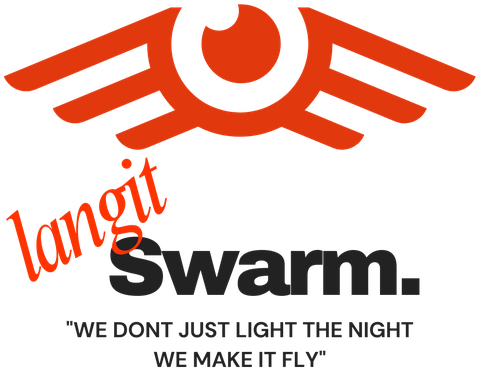
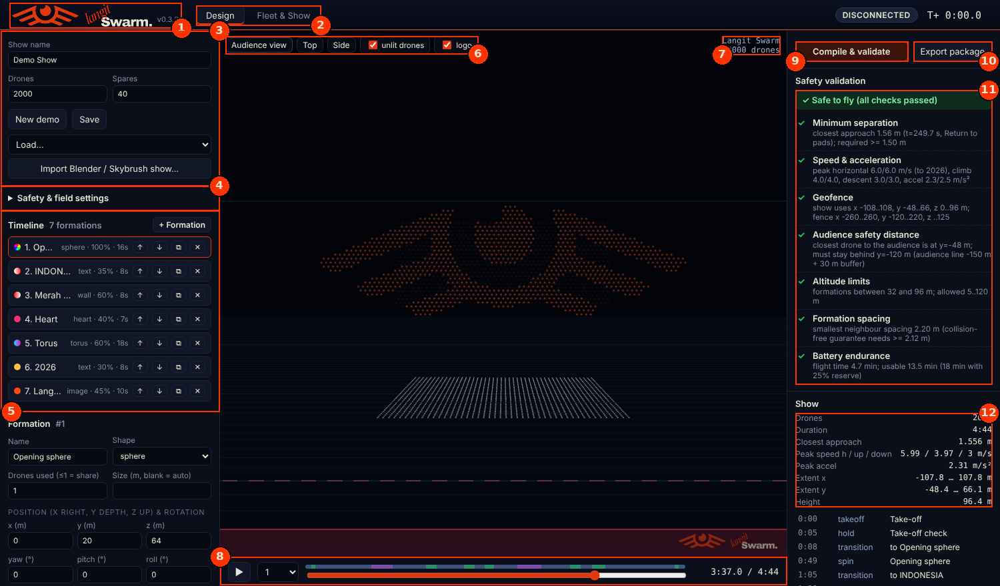

<p align="center"></p>

# Langit Swarm — drone light show designer, simulator and fleet controller

A Windows desktop app for designing and running light shows with **2,000 to 5,000 drones**.
It covers the whole chain: design formations and lights (or **import an animation made in
Blender with Skybrush Studio**), check the show for collisions and limits, rehearse it with a
simulated fleet that has faults, then fly real PX4/ArduPilot drones over MAVLink with live
safety monitoring and emergency controls.

> ⚠️ **Safety first.** Software is one layer of safety, not all of it. Before any real
> flight, work through the rehearsal steps in [Flying real drones](#flying-real-drones),
> get the permits, and keep a trained pilot in command at the emergency controls.

📖 **New to Langit Swarm?** Read the illustrated, step-by-step **[User Guide](docs/USER_GUIDE.md)**:
install, the screen, designing, Blender import, validation, simulator rehearsal and the
emergency controls — with annotated screenshots.

<p align="center"><a href="docs/USER_GUIDE.md"></a></p>

---

## Contents
1. [Features](#features)
2. [Install and run (Windows)](#install-and-run-windows)
3. [Workflow](#workflow)
4. [Importing a show from Blender (Skybrush Studio)](#importing-a-show-from-blender-skybrush-studio)
5. [How the swarm logic works](#how-the-swarm-logic-works)
6. [Flying real drones](#flying-real-drones)
7. [File formats](#file-formats)
8. [Performance](#performance)
9. [Project layout and tests](#project-layout-and-tests)
10. [Known limitations](#known-limitations)
11. [Contributors](#contributors)

---

## Features

**Show design**
- 14 formation types: text (fill or outline, any TTF font), image/logo (colours taken from the
  image), disk, ring, heart, star, wall; sphere, torus, cube, cylinder, cone, wave, and imported
  point clouds (`x,y,z[,r,g,b]`).
- Every formation is sized automatically to fit its drone count at the safe spacing, or to a
  size you choose. A formation can use only part of the fleet; unused drones park unlit on a
  wall behind it.
- Spins (rigid rotation while holding), position, rotation, transition time and hold time per formation.
- 9 light effects: solid, image, gradient, split (e.g. Merah Putih), rainbow, pulse, twinkle,
  wave, off. Lights dim and cross-fade during transitions.

**Swarm logic and safety**
- Collision-free transitions by construction (CAPT assignment + synchronised paths), solved
  in parallel for thousands of drones.
- Speed, climb, descent and acceleration limits respected for every drone.
- Optional downwash factor (treat vertical distance as shorter).
- **Safety validator**: rigorous pairwise separation check over the entire show, speed and
  acceleration, geofence, audience safety line, altitude, spacing, battery endurance.

**Import from Blender (new in 0.2)**
- Imports shows animated in Blender with the Skybrush Studio for Blender add-on: `.skyc`
  (exact Bézier paths and LED programs), `show.json`, or the Skybrush CSV export (`.zip`).
- Keeps each drone's own path, staggered take-off time and light program; place the show on
  the field with rotation and offset; the same safety validator, simulator, export and live
  operations as designed shows.

**3D preview**: audience, top and side views, timeline scrubbing, 5,000 glowing drones in real time.

**Export package (.zip)**: per-drone trajectory CSV, per-drone MAVLink mission
(`.waypoints`, opens in Mission Planner / QGroundControl), per-drone LED programme, keyframes, manifest.

**Fleet operations**
- **Simulator** with configurable pre-flight and in-flight faults (low battery, no RTK,
  sensor fault, drone off its pad, offline drone, battery sag, GPS loss, motor failure, link loss).
- **MAVLink over UDP** for PX4 and ArduPilot. Thousands of drones are told apart by channel +
  IP address + system ID (MAVLink system IDs stop at 254).
- Pad mapping, spare drones, **adaptive re-plan** (the show is re-compiled for exactly the
  drones that are on the field and ready), parallel mission upload with retries.
- Go/No-Go: per-drone checks (link, RTK fix, satellites, battery, sensors, on pad, show
  uploaded) + operator checklist + wind limit.
- Countdown with abort.
- Live monitors at 10 Hz: distance from planned path, RTK loss, critical battery, link loss,
  falling drone, geofence, audience zone.
- Automatic **take-out** of a faulty drone along an escape path checked in space and time.
- Emergency: **HOLD ALL / RESUME**, **COORDINATED RETURN** (collision-free return of every
  airborne drone to the pads), **LAND ALL IN PLACE**, **KILL ALL** (typed confirmation),
  and per-drone land / take out / kill.
- Black box: every event and 1 Hz telemetry of every drone, per show.

---

## Install and run (Windows)

**Ready-made Windows app:** download `LangitSwarm-v0.3.2-windows-x64.zip` from the
[Releases page](https://github.com/yudhis7/LangitSwarm-/releases), right-click → *Extract All*,
then double-click `LangitSwarm.exe` (see `START HERE.txt` inside). No Python needed.
Step-by-step with pictures: [User Guide → Install and start](docs/USER_GUIDE.md#2-install-and-start-the-app).

**From source:**
1. Install **Python 3.11 or 3.12, 64-bit** from python.org (tick *Add python.exe to PATH*).
2. Double-click **`run.bat`**. The first start creates `.venv` and installs the packages
   (a few minutes); then the app window opens.
   - `run.bat --browser` opens it in your browser instead.
   - The window uses Microsoft Edge WebView2, which Windows 10/11 already include.
3. To build a standalone program: double-click **`build_windows.bat`**. The result is
   `dist\LangitSwarm\LangitSwarm.exe`; copy the whole `dist\LangitSwarm` folder to the show laptop.

**If the app window stays black or blank:** wait about a minute — the launcher closes a window
that cannot show the app and opens Langit Swarm in your web browser instead. You can also start
`LangitSwarm.exe --safe-mode` (no GPU acceleration) or `LangitSwarm.exe --browser`; the Windows
package has shortcuts for both. The console shows progress and why a fallback happened; the
same text is saved to `%USERPROFILE%\LangitSwarm\logs\launcher.log`.

Your shows, exports, flight logs and imported Skybrush files are stored in
`%USERPROFILE%\LangitSwarm\` (`shows`, `exports`, `logs`, `imports`). Set the environment variable `LANGIT_HOME` to use another folder.

Recommended show laptop: 8+ CPU cores, 16 GB RAM, a dedicated GPU, wired Ethernet to the drone network.

---

## Workflow

### 1. Design (Design tab)
1. Set the show name, number of drones and spares.
2. Open **Safety & field settings**: minimum separation, speed limits, ceiling, geofence,
   audience line, **location (latitude/longitude) and the direction the audience looks**.
3. Build the timeline: add formations, choose shape, drone share, position, timing, spin and lights.
   Upload logos as PNG with a transparent background.
4. Click **Compile & validate**. Every check must be green before the show may fly.
   Click a conflict or a segment to jump the preview there.
5. **Export package** writes the per-drone files to `%USERPROFILE%\LangitSwarm\exports`.

Coordinates: **x** = to the right as seen by the audience, **y** = depth away from the audience,
**z** = up. The origin is the centre of the take-off field.

Instead of steps 1–3 you can import a show animated in Blender — see the next section.

### 2. Rehearse (Fleet & Show tab → Simulator)
1. Choose *Simulator*, set fault rates, **Connect**.
2. **1 · Map pads & re-plan** → **2 · Upload show** → tick the checklist, enter the wind → **4 · START**.
3. Practise the emergency buttons. Click a drone in the 3D view, the status grid or the event
   log to inspect it and command it.

### 3. Fly (Fleet & Show tab → Real drones)
Same steps with *Real drones — MAVLink UDP* — see the next sections first.

---

## Importing a show from Blender (Skybrush Studio)

The built-in designer is fastest for logos, text and geometric formations. For character
animation, morphing scenes and shows cut to music, animate in **Blender** with the
**Skybrush Studio for Blender** add-on and import the result into LangitSwarm, which then
validates, rehearses and flies it.

### In Blender
1. Install Blender and the Skybrush Studio for Blender add-on (free, GPLv3; ZIP from
   skybrush.io, installed via *Edit › Preferences › Add-ons*). Use a Blender version your
   add-on release supports.
2. Build the show with the add-on: drones on a take-off grid, formations, storyboard
   (take-off, scenes, transitions, landing), light effects. Put the music in the Video
   Sequence Editor to time scenes against it.
3. Orientation: **Blender's Front view (numpad 1) is the audience view** — X to the right,
   Z up, +Y away from the audience. Z = 0 is the ground.
4. In the add-on's *Safety Check* panel use the same limits as LangitSwarm's *Safety & field
   settings* (minimum distance 1.5 m, max horizontal speed 6 m/s, vertical speed 3–4 m/s,
   acceleration 2.5 m/s², altitude 120 m by default) so problems show up while designing.
5. Export from the *Safety & Export* tab: **Export to Skybrush .skyc** (preferred: exact
   paths and LED programs) or **Skybrush CSV** (sampled; export at 4 fps or more).

> **Licence note.** The Blender add-on is free, but transitions and the .skyc/CSV export are
> computed by Skybrush Studio Server. The free community server is shared and
> resource-limited; Skybrush asks commercial show companies and large fleets to license
> Skybrush Studio Server (local) or Skybrush Studio Cloud. Check skybrush.io for current
> terms and budget for it.

### In LangitSwarm
1. **Design → Import Blender / Skybrush show…** and pick the `.skyc`, `show.json` or CSV `.zip`.
   Your formation timeline is kept and comes back with **Remove import**.
   To try it without Blender, import `samples/sample_100_drones.skyc`.
2. **Placement on the field:** the pad grid is centred on the take-off field automatically.
   *Rotate* turns the show about the centre of its pad grid; *Offset x/y* moves it.
   *Centre on take-off field* re-centres it.
3. **Compile & validate** — the same safety checks as designed shows: separation of every
   pair over the whole show (sampled every 0.2 s with the closest approach between samples),
   speed (fail) and acceleration (warning — sampled paths have corners the autopilot smooths),
   geofence, audience line, altitude between take-off climb and landing, pad spacing, battery.
4. **Export package**, rehearse in the simulator, then fly — exactly as for designed shows.

### What the importer reads
| From the Skybrush file | In LangitSwarm |
|---|---|
| Trajectories (Bézier segments up to cubic; also sampled v0/v2 and CSV) | each drone's path, exactly; CSV is simplified to 2 cm |
| `takeoffTime` per drone | **staggered take-off**: each drone waits on its pad until its time |
| Trajectories starting at ~1 m / ending in the air | a 1 m/s vertical climb from the pad / landing is added (shown in *Import notes*) |
| Home / first point | one pad per drone |
| LED program (set, fade, gray/black/white, sleep, wait-until, loops) | decoded exactly, exported as 25 fps `.lights` files |
| Cues (time markers) | timeline labels |
| Validation limits, music, real-world location | shown for reference (play the music from the show audio system) |
| Yaw setpoints, pyro programs | ignored (listed in *Import notes*) |

Spares stand by but cannot replace a missing drone, because every pad has its own path. If a
drone is not ready, its path is left out of the live plan (subject to *min ready share*).

### How an imported show flies
- **Missions:** each drone gets TAKEOFF to 2.5 m, then timed waypoints along its path down to
  2.5 m, then LAND. Paths are simplified with a *synchronised* distance (position at the same
  moment, not just the same line) to the *Mission path tolerance* (0.25 m default), loosened
  automatically for drones that would exceed *Max mission items* (700 default). Every leg gets a
  DO_CHANGE_SPEED (horizontal and vertical) so it takes its planned time; hovers become holds,
  or NAV_DELAY until UTC in `utc_delay` mode (ArduPilot), which re-synchronises the fleet.
  With ideal constant-speed legs the missions stay within 0.2 m of the Skybrush path in tests;
  real autopilots add acceleration lag, which the live path-deviation monitor watches.
- **Staggered take-off:** the ground station arms and starts each drone at its own take-off
  time. **HOLD ALL** also pauses drones still waiting on their pads (they resume with the
  show); **LAND ALL**, **COORDINATED RETURN** and **KILL ALL** cancel take-offs that have not
  happened yet, so those drones stay on the ground.
- For the tightest timing with thousands of drones, an onboard show player that follows the
  exported Bézier CSV against GPS time is the professional route (see
  [Mission mode vs. onboard show player](#mission-mode-vs-onboard-show-player)).

---

## How the swarm logic works

**Collision-free transitions (CAPT).** Moving thousands of drones from one formation to the
next without collisions is solved with the result of Turpin, Michael & Kumar
(*Concurrent assignment and planning of trajectories for multiple robots*, IJRR 2014):
if every drone flies a straight line, all drones start and finish at the same time with the
same speed profile, and the drone-to-target assignment minimises the **sum of squared
distances**, then no two drones get closer than *(smallest start/goal spacing) / √2*.
LangitSwarm therefore spaces every formation and the take-off pads at least
**√2 × minimum separation** apart (2.2 m for a 1.5 m separation), which makes every
transition safe by construction. The validator still re-checks every pair at every moment.

**Fast for 5,000 drones.** The optimal assignment is solved exactly (network-simplex optimal
transport, with Jonker-Volgenant and SciPy as fallbacks). Because the assignment between two
point *sets* does not depend on which drone is where, all transitions of a show are solved in
parallel processes and then chained. Results are cached, so editing one formation only
re-solves its two transitions.

**Timing.** Every move uses a minimum-jerk profile; its duration is the shortest that keeps
every drone within the horizontal, climb, descent and acceleration limits.

**Partial formations.** When a formation uses fewer drones than the fleet, the rest fly to an
unlit parking wall behind it (away from the audience) so they never block the next transition.

**Adaptive re-plan.** On the field, each drone is matched to its nearest pad. Drones failing
checks are left out, spares fill the gaps, and the show is re-compiled and re-validated from
the pads of the drones that will really fly. If fewer drones are ready than planned (but at
least the configured minimum share), formations are re-sampled with fewer drones.

**Live monitoring.** The controller compares each drone with its planned path (path distance,
so missions flown at constant speed are not falsely flagged), watches RTK fix, battery, link,
geofence and the audience line, and takes a faulty drone out of the show: it searches escape
routes (straight down, outwards from a 3D shape, backwards out of the formation plane,
sideways, up and over) and checks every point of a route against where the other drones
*will be* when it gets there. If no route is clear yet, the drone holds and the search is
repeated every 2 s.

**Link loss and HOLD.** A drone without link cannot receive HOLD, so it keeps flying the show
on the original clock while the others stop - their paths could then cross. The app therefore
asks for explicit confirmation before HOLD or RETURN when airborne drones have no link, and
refuses RESUME while drones that missed the HOLD are still flying. Usually the safest choice
is to let the show continue and take only the faulty drones out.

**Coordinated return.** All airborne drones stop, spread out if they are closer than √2 × the
separation (a uniform expansion only increases distances), then fly to the landing layer with
a CAPT assignment and per-drone speeds that make them arrive together, then land vertically.
**LAND ALL IN PLACE** is faster but drones may descend onto drones below them — use it only
when return is not possible.

---

## Flying real drones

### Rehearsal ladder (do not skip steps)
1. Simulator rehearsals with faults switched on, including every emergency button.
2. **MAVLink emulator**: `python tools/mavlink_emulator.py --drones 300 --gcs 127.0.0.1:14550`,
   then connect the app to `udp:0.0.0.0:14550`. This exercises the real network code.
3. **ArduPilot SITL** with a few drones, to confirm modes, parameters and mission behaviour of
   your firmware version.
4. Field tests: 1 → 10 → 50 → 200 → 1,000 → full fleet. Drill HOLD, RETURN and LAND at each step.

### Drone network for thousands of drones
- MAVLink system IDs are one byte (1–254). LangitSwarm identifies a drone by
  *(channel, IP address, system ID)*, so drones may share system IDs as long as each has its
  own IP address, or you can run several UDP channels (e.g. 20 networks × 250 drones),
  one line per channel in the endpoint box.
- Telemetry requested per drone: position 2 Hz, status/GPS/landed state 1 Hz, battery 0.5 Hz
  (~6 messages/s, roughly 250 B/s). 5,000 drones ≈ 1.3 MB/s into the ground station, which
  pymavlink parses comfortably on one core.
- Use a professional show network (several access points or a mesh with directional
  antennas, channel planning, spectrum scan on site) and wire the ground station by Ethernet.
- RTK: run a base station and inject corrections to every drone; the default pre-flight check
  requires an RTK fixed solution (`require_rtk`).

### ArduPilot (Copter) settings to review on every drone
| Parameter | Value | Why |
|---|---|---|
| `AUTO_OPTIONS` | 3 | arm and take off in AUTO without throttle |
| `FS_GCS_ENABLE` | 0 | a drone that loses the link keeps flying its show |
| `FENCE_ENABLE`, `FENCE_TYPE`, `FENCE_ALT_MAX`, `FENCE_ACTION` | per site | onboard geofence as a second layer |
| `BATT_FS_LOW_ACT`, `BATT_FS_CRT_ACT` | land | onboard battery failsafe |
| `SCR_ENABLE` | 1 | runs the LED player script |
| `SERVOx_FUNCTION` | 94 | LED data output for the script |

Copy `lua/langit_lights.lua` and the drone's `lights/drone_XXXX.lights` file (renamed to
`show.lights`) to `APM/scripts/` on the SD card. The app sets `SCR_USER1` to the show start
time so all LEDs follow the GPS clock. The script is a **template: bench-test it first.**
Verify every parameter name against your firmware's parameter list.

### PX4
Set `NAV_DLL_ACT = 0` (continue mission on data-link loss), review `COM_RCL_EXCEPT`, `GF_ACTION`
and the battery failsafe. The `utc_delay` mission sync and the Lua LED player are ArduPilot-only;
on PX4 drive LEDs from a companion computer with the exported light files.

### Mission mode vs. onboard show player
The app flies stock firmware with per-drone missions: every move is a waypoint with a speed
chosen so that all drones arrive together, and hold times keep the timeline. With
`mission_sync = utc_delay` (ArduPilot) every hold ends at an absolute UTC time, which
re-synchronises the fleet at each formation. This works well for rehearsals and small to
medium fleets. For thousands of drones in a public show, the professional approach is an
**onboard show player** that follows the exported trajectory against GPS time
(the open-source Skybrush ArduCopter fork works this way and is worth evaluating). The
exported `trajectories/*.csv` and `lights/*.lights` files are designed for such a player.

### Indonesia: permits
Drone operations fall under the Ministry of Transportation rules **PM 37/2020** (UAS operation
in Indonesian airspace) and **PM 63/2021** (CASR Part 107, small UAS). The default ceiling in
the app is therefore **120 m (400 ft)**; PM 37/2020 states that operations are in principle
daylight-only, so a night show needs explicit approval from DJPU (Directorate General of Civil
Aviation) and airspace coordination with AirNav Indonesia. The rules were under revision in
2026 — confirm the current requirements with DJPU before planning. This is not legal advice.

---

## File formats

**Show (`.json`)** — the editable design (see `langit/show/spec.py` for every field).

**Export package (`.zip`)**
```
manifest.json                  summary, origin, pad list, segment list, light file format
show.json                      the design
keyframes.npz                  keyframe positions of every drone (numpy)
trajectories/drone_0001.csv    t0,t1,kind,x0,y0,z0,x1,y1,z1,lat1,lon1,alt1,lit,spin_deg,axis,cx,cy,cz
missions/drone_0001.waypoints  QGC WPL 110 mission
lights/drone_0001.lights       "LSL1", uint16 fps, uint16 version, uint32 frames, uint32 drone, uint32 0,
                               then R,G,B bytes per frame (little endian)
```
Position between keyframes: `P0 + s(τ)·(P1−P0)`, with `τ = (t−t0)/(t1−t0)` and
`s = 10τ³ − 15τ⁴ + 6τ⁵`; spin rows rotate about the given axis through the centre.

**Imported (Skybrush) shows** export the same package, with two differences:
`imported_show.npz` replaces `keyframes.npz` (all paths, control points, light keys and
take-off times), and each trajectory CSV lists the exact cubic Bézier segments:
```
t0,t1,x0,y0,z0,c1x,c1y,c1z,c2x,c2y,c2z,x1,y1,z1,lat1,lon1,alt1
P(u) = (1-u)³P0 + 3(1-u)²u·C1 + 3(1-u)u²·C2 + u³P1,  u = (t-t0)/(t1-t0)
```
`manifest.json` adds `takeoff_s` (each drone's take-off time) and an `imported` summary.

**Flight logs** (`logs/<time>_<show>/`): `events.jsonl`, `telemetry.bin`
(read with `langit.fleet.blackbox.read_telemetry`), `show.json`, `gonogo.json`.

---

## Performance
Measured on a 2-core test machine:

| | 2,000 drones | 5,000 drones |
|---|---|---|
| Compile demo show (6 formations) | ~4 s | ~45 s (2 cores; ~3× faster with 3 worker processes on an 8-core laptop) |
| Safety validation (all pairs, whole show) | ~1.5 s | ~5.5 s |
| Simulator + controller update (10 Hz loop) | ~3 ms | ~8 ms |
| MAVLink parsing | ~180,000 messages/s on one core | |

Imported Skybrush show, 5,000 drones, 10-minute synthetic show (same 2-core machine):
parse 1.6 s (then cached), validation 13 s, 3D preview frame 1.4 ms, all 5,000 missions 23 s,
export package 17 s, ~0.5 GB RAM. Real Studio exports have more path segments, so parsing and
validation take somewhat longer.

---

## Project layout and tests
```
app.py                     desktop entry point (window via pywebview, or browser)
langit/server.py           local web server: REST + WebSocket (binary 3D frames)
langit/geo.py              show frame <-> GPS
langit/show/               spec, formations, assignment (CAPT), trajectory, lights,
                           compiler, validator, mission, export, importer (Skybrush)
langit/fleet/              state, simulator, MAVLink link, pre-flight, controller, black box
web/                       operator UI (Three.js)
tools/mavlink_emulator.py  hundreds of virtual MAVLink drones for network tests
lua/langit_lights.lua      ArduPilot LED player (template)
tests/                     engine tests, simulator rehearsal, MAVLink end-to-end test
```
```
python tests/test_engine.py         # formations, compile, validator (incl. a forced collision), export
python tests/sim_flow.py 2000       # full simulated show with faults and HOLD/RESUME
python tests/test_mavlink.py        # app <-> 40 emulated MAVLink drones over UDP, full show
python tests/test_import.py         # Skybrush importer: Bezier paths, LED bytecode, CSV, validation,
                                    #   missions, export, 1,600-drone performance [file.skyc ...]
python tests/sim_flow_import.py     # imported show in the simulator: HOLD during staggered take-off, LAND ALL
python tests/test_mavlink_import.py # imported show over UDP: staggered take-off, missions, landing
python tests/test_server_import.py  # import API: upload, placement, export, autosave, remove
```

**Windows release build (GitHub Actions):** *Actions → Windows release → Run workflow* (enter a
tag such as `v0.3.3`) builds `LangitSwarm.exe` on a Windows runner, runs the engine tests and a
start-up smoke test, and publishes the zip as a GitHub release. Pushing a `v*` tag does the same.

---

## Known limitations
- The MAVLink link is tested against the bundled emulator, **not yet against real autopilots**.
  Validate with ArduPilot SITL and bench drones before field tests.
- Escape routes for faulty drones and the coordinated return over MAVLink are best effort
  (GUIDED moves at constant speed); the operator stays responsible.
- The LED script is a template; music/timecode sync, RTK base management and weather feeds
  are not included yet.
- The Windows build script has to run on Windows (PyInstaller cannot cross-compile).
- Imported shows: tested against synthetic Skybrush files and Skybrush's public demo show,
  not yet against a large production export — import your real show and review the *Import
  notes* and validation before rehearsing. Yaw and pyro are not supported; music is not
  played by the app. Light commands outside the Skybrush LED format stop that drone's light
  program, as the Skybrush firmware does.

---

## Contributors
- [**@yudhis7**](https://github.com/yudhis7) — founder and project owner: product vision and
  requirements, the Langit Swarm brand, Windows testing.
- Claude (Anthropic) — AI pair programmer: code and documentation.

See [CONTRIBUTORS.md](CONTRIBUTORS.md) for how to contribute.
