
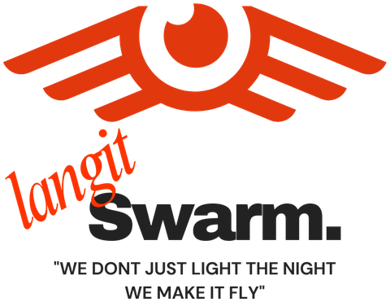

# Langit Swarm — User Guide

**Step-by-step, with pictures.** Version 0.3.2 · Windows 10/11 (64-bit)

This guide takes you from download to a rehearsed drone show: install the app, find your way
around the screen, design a show (or import one from Blender), check that it is safe, export it,
and rehearse it with the simulated fleet, including the emergency controls. Numbers in red
circles in the pictures match the numbered lists under them.

> Langit Swarm is a tool for trained show crews. Software is only one layer of show safety:
> fly only with a valid permit, a secured site, rehearsals, and a pilot in command at the
> emergency controls.

## Contents
1. [What you need](#1-what-you-need)
2. [Install and start the app](#2-install-and-start-the-app)
3. [A tour of the screen](#3-a-tour-of-the-screen)
4. [Design a show](#4-design-a-show)
5. [Safety & field settings](#5-safety--field-settings)
6. [Compile & validate](#6-compile--validate)
7. [Import a show from Blender (Skybrush Studio)](#7-import-a-show-from-blender-skybrush-studio)
8. [Export the show package](#8-export-the-show-package)
9. [Rehearse with the simulator](#9-rehearse-with-the-simulator)
10. [Emergency controls](#10-emergency-controls)
11. [Flying real drones](#11-flying-real-drones)
12. [Troubleshooting](#12-troubleshooting)
13. [Where your files are](#13-where-your-files-are)

---

## 1. What you need

| | |
|---|---|
| Computer | Windows 10 or 11, 64-bit. 8 GB RAM or more for shows with 3,000+ drones; a dedicated graphics card makes the 3D preview smoother. |
| App window | Microsoft Edge WebView2 Runtime (built into Windows 11 and most Windows 10 PCs). Without it the app opens in your web browser instead — everything works the same. |
| For Blender shows | Blender with the free *Skybrush Studio for Blender* add-on (see [section 7](#7-import-a-show-from-blender-skybrush-studio)). |
| For real drones | PX4 or ArduPilot drones with RTK GPS, a MAVLink radio network, and the LED player on each drone (see the [README](../README.md#flying-real-drones)). |

---

## 2. Install and start the app

### 2.1 Download and extract

1. Open the [Releases page](https://github.com/yudhis7/LangitSwarm-/releases) and download
   **`LangitSwarm-v0.3.2-windows-x64.zip`** (about 70 MB).
2. In File Explorer, **right-click the zip → Extract All… →** choose a permanent folder, for
   example `C:\LangitSwarm` → **Extract**.
   - Do **not** start the program from inside the zip: Windows would copy only the `.exe`, and
     it cannot run without the `_internal` folder next to it.
3. Open the extracted `LangitSwarm` folder. It contains:

   | File / folder | What it is |
   |---|---|
   | `LangitSwarm.exe` | the app — double-click to start |
   | `_internal\` | the app's program files (leave them where they are) |
   | `LangitSwarm.exe.config` | settings for the app window — keep it next to the `.exe` |
   | `Open in browser.cmd` | starts the app in your web browser instead of its own window |
   | `Safe mode (no GPU).cmd` | starts the app window without graphics acceleration |
   | `samples\sample_100_drones.skyc` | a small Blender/Skybrush show to try the importer |
   | `START HERE.txt`, `README.md`, `CHANGELOG.md` | quick start, full manual, version history |

### 2.2 First start

1. **Double-click `LangitSwarm.exe`.**
2. **"Windows protected your PC"** (SmartScreen) may appear, because the app is not code-signed
   yet. Click **More info**, then **Run anyway**. You only need to do this once per version.
3. **Windows Firewall** may ask whether the app may use the network. Choose **Private networks**
   and click **Allow**. The app needs this to talk to real drones over MAVLink; the screen itself
   is served only to your own computer.
4. A **black console window** opens first. It is the app's log — keep it open; closing it
   closes the app. The first start can take up to a minute while Windows checks the files.

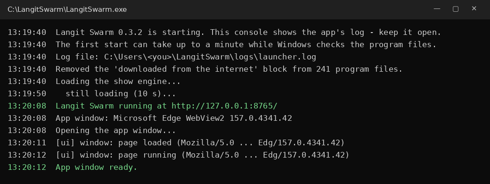
*The console during a normal start (illustration). "App window ready." means everything worked.*

5. The **splash screen** with the Langit Swarm logo appears, then the main screen.

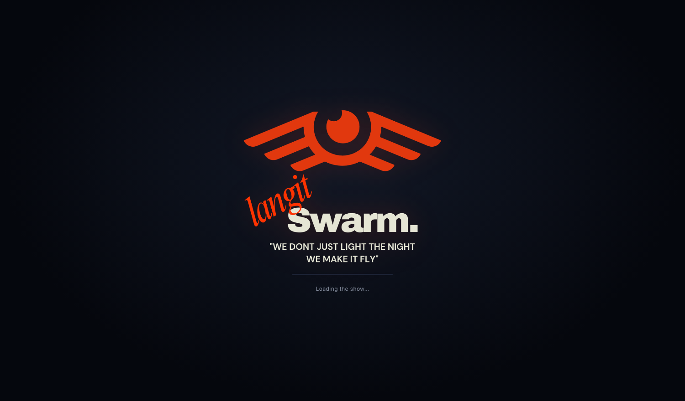

> **If the app window stays black or blank**, wait about a minute: the app then closes that
> window and opens itself in your web browser automatically. See
> [Troubleshooting](#12-troubleshooting) for the other options.

---

## 3. A tour of the screen

The app has two tabs: **Design** (create and check the show) and **Fleet & Show** (rehearse and
fly it). This is the Design tab with the demo show, paused on its finale — 2,000 drones forming
the Langit Swarm emblem.

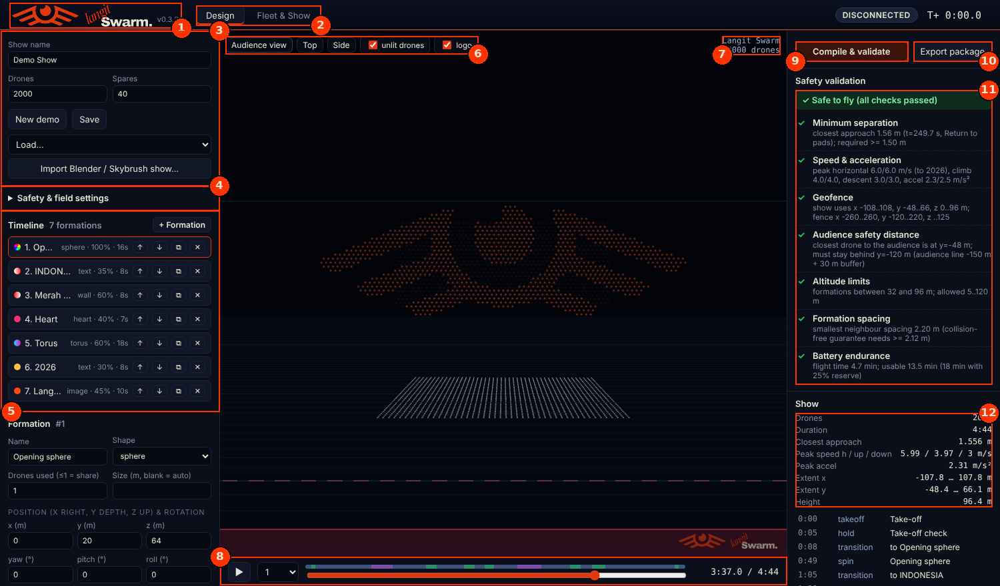

1. **Logo** — click it for the *About* box (version and the folder where your files are kept).
2. **Tabs** — *Design* and *Fleet & Show*.
3. **Show header** — show name, number of drones and spares; **New demo**, **Save**, **Load…**,
   and **Import Blender / Skybrush show…**
4. **Safety & field settings** — limits and the show location (click to open, [section 5](#5-safety--field-settings)).
5. **Timeline** — the formations of the show, in order. Click one to edit it below the list.
6. **View tools** — *Audience view*, *Top*, *Side*; show or hide *unlit drones*; show or hide
   the *logo* on the 3D view (handy to switch off for clean recordings).
7. **Now showing** — the current formation and its drone count.
8. **Time bar** — play/pause, playback speed, and the scrubber. Coloured strips above the
   scrubber are the show's scenes (take-off, transitions, holds, spins, landing).
9. **Compile & validate** — turns the timeline into flight paths and runs every safety check.
10. **Export package** — writes the files the drones need ([section 8](#8-export-the-show-package)).
11. **Safety validation** — the verdict and each check (green ✓ pass, amber ! warning, red ✗ fail).
12. **Show** — key numbers: drones, duration, closest approach, peak speeds, size of the show.
    Below it, a list of all scenes: **click a scene to jump to it**.

**Moving the 3D view:** drag with the left mouse button to orbit, the right button to pan, and
the mouse wheel to zoom. *Audience view* puts you back where the spectators stand.

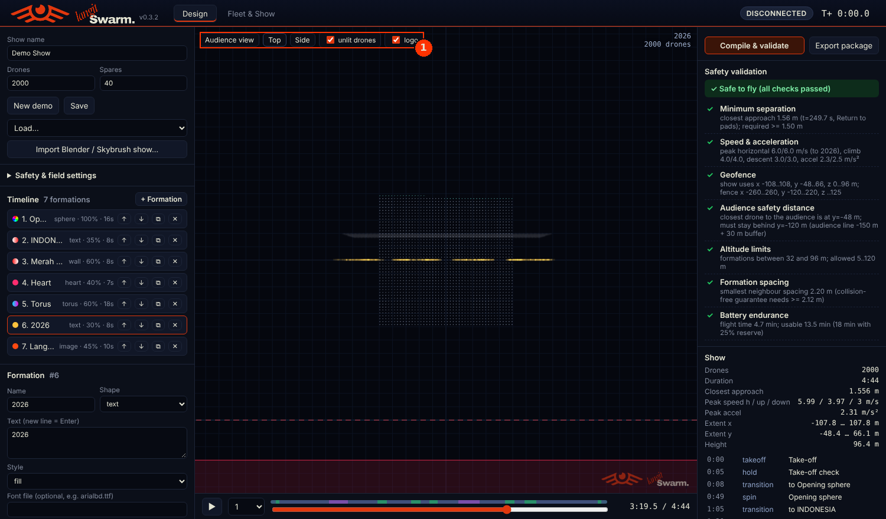
*Top view (1): the same moment seen from above — useful to check the take-off grid and the
distance to the audience line.*

---

## 4. Design a show

### 4.1 Start a show

- **New demo** fills the timeline with the demo show (sphere, text, wall, heart, torus, "2026",
  emblem) for the drone count you typed in **Drones**. It is a good starting point to edit.
- **Drones** is the number of drones that fly the show; **Spares** are extra drones on the field
  that replace any drone that is not ready on show day.
- **Save** stores the show; **Load…** opens a saved one. Your current work is also saved
  automatically and comes back the next time you start the app.

### 4.2 Work with the timeline

Each line of the timeline is one formation: number, name, shape, how many of the drones it uses,
and how long it holds. The small buttons on each line:

| Button | Does |
|---|---|
| ↑ ↓ | move the formation earlier / later |
| ⧉ | duplicate it |
| ✕ | delete it |
| **+ Formation** (top of the list) | add a new formation at the end |

### 4.3 Edit a formation

Click a formation in the timeline; its settings appear below the list. This example is the
"2026" text formation.

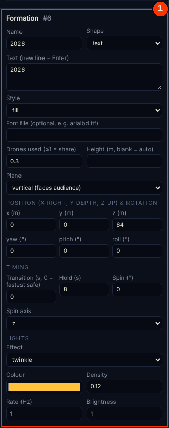

| Field | Meaning |
|---|---|
| **Name / Shape** | Shapes: `text`, `image`, `disk`, `ring`, `heart`, `star`, `wall` (flat) and `sphere`, `torus`, `cube`, `cylinder`, `cone`, `wave`, `points` (3D). |
| **Shape options** | Depend on the shape: e.g. *Text* and *Style* for text, a picture file for `image` (use a PNG with a transparent background — its colours can drive the lights). |
| **Drones used** | `≤ 1` = a share of the fleet (0.3 = 30 %), `> 1` = an exact number. Unused drones wait, unlit, out of the way. |
| **Height / Size** | Leave blank to size the formation automatically at the safe spacing. |
| **Plane** | Flat shapes: *vertical* (faces the audience) or *horizontal* (seen from below). |
| **Position & rotation** | Centre in metres — **x** to the right, **y** away from the audience, **z** up — and yaw / pitch / roll in degrees. |
| **Transition** | Seconds to fly into this formation; `0` = as fast as the speed limits allow. |
| **Hold / Spin** | Seconds to stay in the formation, and an optional spin (degrees, axis) during the hold. |
| **Lights** | Effect (`solid`, `image`, `gradient`, `split`, `rainbow`, `pulse`, `twinkle`, `wave`, `off`), colour(s), density, rate and brightness. |

After editing, the right panel shows *"Show changed — compile to update the preview."* Click
**Compile & validate** to see the result.

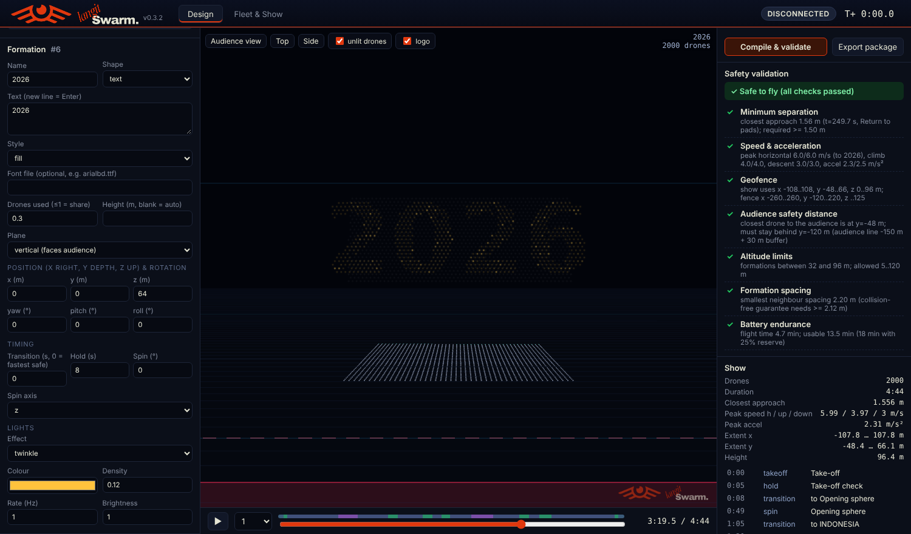
*The "2026" formation selected in the timeline and shown in the 3D view.*

### 4.4 Preview

Press ▶ on the time bar, choose a playback speed, or drag the scrubber. Use **Top** and **Side**
to check spacing and height, and click scenes in the *Show* list to jump straight to them.

---

## 5. Safety & field settings

Open **Safety & field settings** in the left panel. Set these once per venue — they apply to
every show you compile.

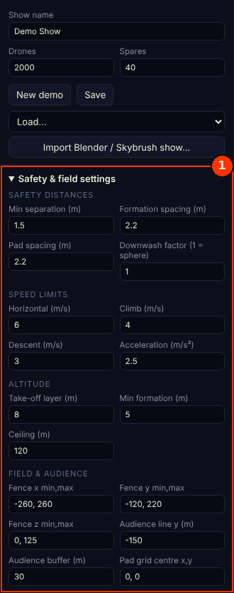

| Group | What to set |
|---|---|
| **Safety distances** | Minimum separation between drones, formation spacing, pad spacing on the take-off field, downwash factor. |
| **Speed limits** | Horizontal, climb and descent speed, acceleration — keep them at or below what your drones fly reliably. |
| **Altitude** | Take-off layer, lowest formation height, ceiling (your permit's limit). |
| **Field & audience** | Geofence box, where the audience line is, the safety buffer, and the centre of the pad grid. |
| **Location** | Latitude, longitude, ground altitude, and the direction the audience looks — this ties the show to the real place. |
| **Battery & lights** | Battery endurance and reserve, brightness during transitions, light file rate, take-off colour. |
| **Live operations** | Thresholds used during the show: path deviation warning / take-out, battery minimums, RTK and satellites, max pad offset, minimum share of ready drones, max wind, mission sync, max mission items. |

---

## 6. Compile & validate

Click **Compile & validate**. The app assigns every drone to its place in every formation,
plans collision-free transitions, and runs the safety checks. A 3,000-drone show takes about
10–30 seconds; progress shows under the buttons.

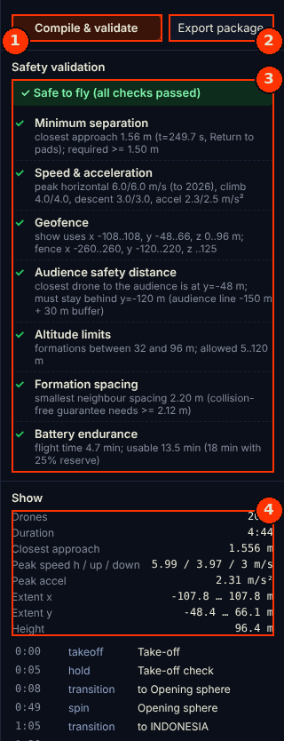

1. **Compile & validate**
2. **Export package**
3. **Safety validation** — the verdict and each check:
   - *Minimum separation* — the closest any two drones ever get, at what time.
   - *Speed & acceleration* — peaks against your limits.
   - *Geofence* and *Audience safety distance* — the show stays inside the fence and behind the
     audience line plus buffer.
   - *Altitude limits*, *Formation spacing*, *Battery endurance* (flight time against usable
     battery).
4. **Show** — the key numbers, and the scene list below it.

**If a check fails (red ✗):** read its detail line — it names the drones, the time and the
value. Typical fixes: lengthen the *Transition* of the formation it names, use fewer drones or a
bigger size, move the formation further from the audience, or lower its height. Compile again
until the verdict reads **✓ Safe to fly**. The *Fleet & Show* tab re-checks the show for the drones really on the
field and will not plan or upload a show that fails.

---

## 7. Import a show from Blender (Skybrush Studio)

For animated shows — characters, morphing scenes, shows cut to music — design in Blender and
import the result.

### 7.1 In Blender

1. Install Blender and the **Skybrush Studio for Blender** add-on (free, from skybrush.io):
   *Edit → Preferences → Add-ons → Install…* → choose the add-on zip → tick it.
2. Build the show with the add-on: take-off grid, formations, storyboard with transitions,
   light effects. Put the music in Blender's Video Sequence Editor to time the scenes.
3. Design looking through Blender's **Front view** (numpad 1) — that is what the audience will
   see (X to the right, Z up, +Y away from the audience; Z = 0 is the ground).
4. In the add-on's **Safety Check** panel use the same limits as in Langit Swarm
   ([section 5](#5-safety--field-settings)) so problems show up while you design.
5. Export: **Safety & Export** tab → **Export to Skybrush .skyc** (best: exact paths and lights)
   or **Skybrush CSV** (sampled; 4 fps or more).

> The .skyc/CSV export is computed by Skybrush's online Studio Server. The free community server
> is shared and limited; Skybrush asks commercial companies and large fleets to license their
> Studio Server or Studio Cloud. Check skybrush.io for current terms.

### 7.2 In Langit Swarm

1. **Design tab → Import Blender / Skybrush show…** → pick the `.skyc`, `show.json` or CSV `.zip`.
   (To try it now, use `samples\sample_100_drones.skyc` from the app folder.)
2. The show is placed on the take-off field automatically, compiled and validated.

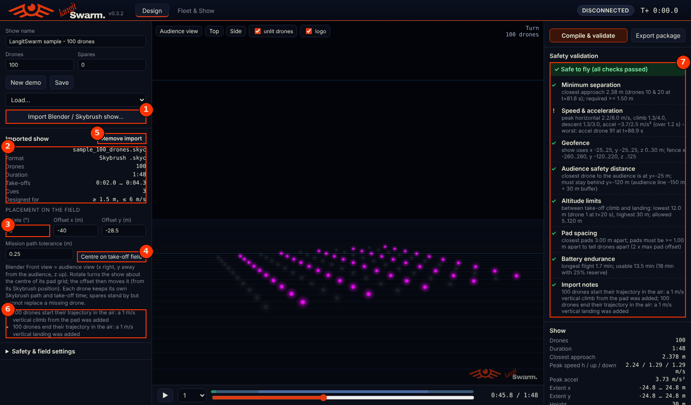

1. **Import Blender / Skybrush show…**
2. **Imported show** — file, format, number of drones, duration, take-off window, cues, and the
   limits it was designed for.
3. **Placement** — *Rotate* turns the show about the centre of its pad grid; *Offset x / y* moves
   it on the field. *Mission path tolerance* sets how closely the drones' waypoint missions
   follow the curves (0.25 m is a good default).
4. **Centre on take-off field** — puts the pad grid back in the middle of the field.
5. **Remove import** — returns to your own formation timeline (it was kept).
6. **Import notes** — what the importer adjusted, for example *a 1 m/s vertical climb was added*
   because Skybrush trajectories start 1 m above the ground.
7. **Safety validation** — the same checks as for designed shows, plus *Pad spacing* and
   *Import notes*.

**Good to know**
- Every drone keeps its own Skybrush path, light program and take-off time — take-offs can be
  staggered row by row.
- After changing placement or tolerance, click **Compile & validate** again.
- Spare drones stand by but cannot replace a missing drone in an imported show, because every
  pad has its own path.
- Yaw and pyro programs from Skybrush are ignored; the music is not played by the app — start it
  from your show audio system.

---

## 8. Export the show package

Click **Export package** after compiling — export only shows that passed validation. The app writes one zip with
everything the drones and your crew need; click **Download .zip** to save it.

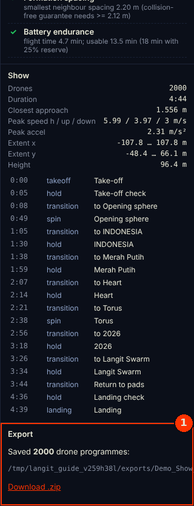

The package contains, for every drone: the flight path (`trajectories\drone_0001.csv`), the
waypoint mission (`missions\drone_0001.waypoints`, QGroundControl format) and the light program
(`lights\drone_0001.lights`), plus `manifest.json` with the pad of every drone and the show
summary. The [README](../README.md#file-formats) describes every file format.

---

## 9. Rehearse with the simulator

Always rehearse a show with the simulated fleet first. The simulator behaves like real drones,
including random faults you can switch on, and uses exactly the same controls as a real show.

### 9.1 Connect

Switch to the **Fleet & Show** tab.

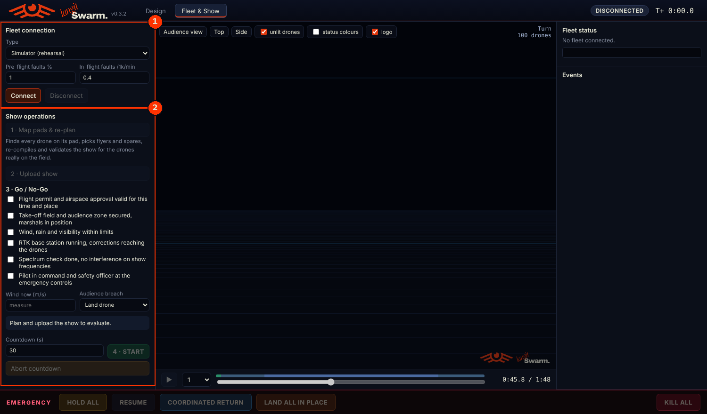

1. **Fleet connection** — *Type*: **Simulator (rehearsal)** or *Real drones — MAVLink UDP*. For the
   simulator, *Pre-flight faults %* makes some drones not ready, and *In-flight faults* makes
   some develop problems during the show (per 1,000 drones per minute). Click **Connect**.
2. **Show operations** — the four steps of every show, done in order.

### 9.2 Map pads, re-plan and upload

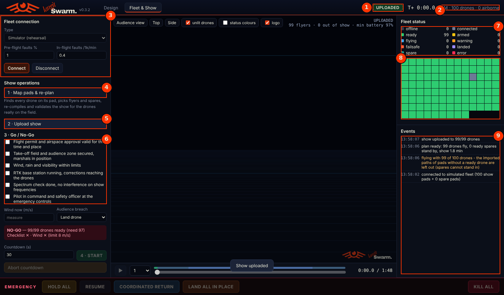

1. **State** — where the show is: *CONNECTED → PLANNED → UPLOADED → COUNTDOWN → RUNNING →
   FINISHED* (or *HOLDING*, *RETURNING*, *LANDING*, *ABORTED*).
2. **Fleet summary** — how many drones are known and airborne.
3. **Fleet connection.**
4. **1 · Map pads & re-plan** — finds every drone on its pad, picks the flyers (and spares to
   fill any gaps), then re-compiles and re-validates the show for the drones really on the field.
5. **2 · Upload show** — sends each drone its mission.
6. **3 · Go / No-Go checklist** (next step).
7. **Fleet status counts** — offline, connected, ready, armed, flying, warning, failsafe, landed,
   spare, error.
8. **Status grid** — one square per drone, coloured by status. Hover for the drone number;
   click a square for its details.
9. **Events** — everything that happens, newest first. Orange and red lines need attention.

### 9.3 Go / No-Go and start

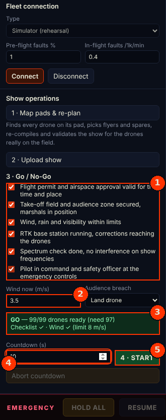

1. **Checklist** — tick each item only when it is really true: permit, secured site, weather,
   RTK corrections, spectrum check, pilot in command and safety officer at the emergency controls.
2. **Wind now** — enter the measured wind; choose what happens if a drone breaches the audience
   line (*Land drone* or *Stop motors*).
3. **Verdict** — **GO** only when enough drones are ready, the checklist is complete and the wind
   is within the limit. Otherwise it says **NO-GO** and why.
4. **Countdown** — seconds before take-off.
5. **4 · START** — starts the countdown. **Abort countdown** stops it before take-off.

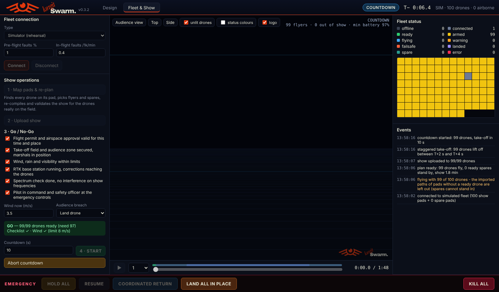
*During the countdown the header shows COUNTDOWN and the T− clock, the drones are armed (yellow),
and **Abort countdown** is the way out. The event log shows the staggered take-off plan.*

### 9.4 During the show

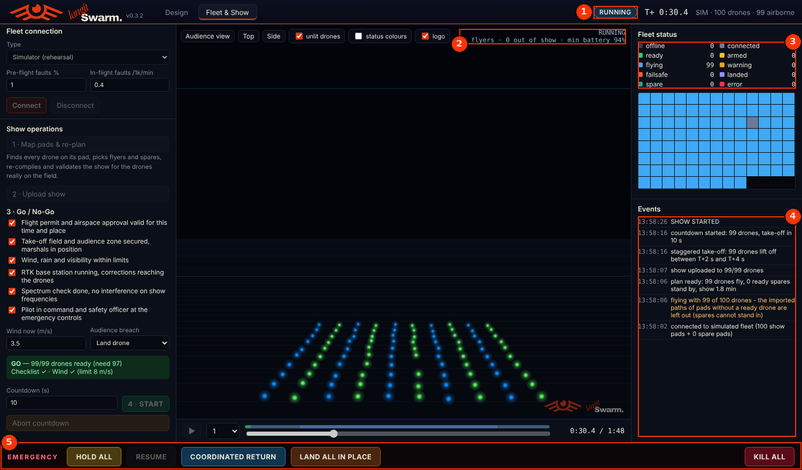

1. **State** — *RUNNING* and the show clock (T+).
2. **Live view** — the 3D view now shows where the drones really are.
3. **Fleet status** — watch *warning*, *failsafe* and *error*.
4. **Events** — e.g. a drone taken out of the show because it strayed too far from its path.
5. **Emergency bar** — appears whenever drones are airborne ([section 10](#10-emergency-controls)).

**One drone:** click its square in the status grid (or the drone in the 3D view) to see its
details and act on that drone only.

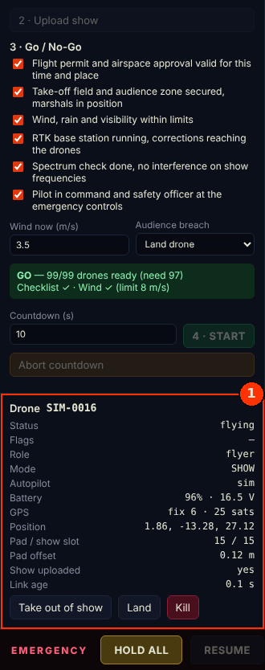

1. **Drone panel** — status, role, flight mode, battery, GPS fix and satellites, position, pad,
   pad offset, link age. **Take out of show** flies it out of the formation and lands it;
   **Land** lands it where it is; **Kill** stops its motors (last resort).

---

## 10. Emergency controls

The emergency bar sits at the bottom of the screen while drones are in the air.

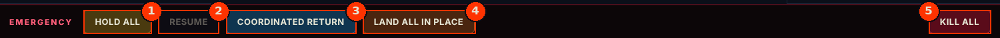

| | Button | What it does | When to use it |
|---|---|---|---|
| 1 | **HOLD ALL** | Every drone stops and hovers in place; drones still waiting to take off stay on their pads. If some drones have lost their link (they cannot pause), the app asks first. | First reaction to anything unexpected: an intruder, a sudden wind gust, a stage problem. |
| 2 | **RESUME** | Continues the show from where it was held. | When the problem is cleared. |
| 3 | **COORDINATED RETURN** | Drones spread apart if needed, fly without crossing paths to a landing layer above the take-off field, then land. | Ending the show early in a controlled way. |
| 4 | **LAND ALL IN PLACE** | Every drone descends straight down where it is (asks for confirmation). | Only when flying back is not possible — drones above others may descend onto them. |
| 5 | **KILL ALL** | Stops all motors; drones fall. You must type **KILL** to confirm. | Only when continued flight is more dangerous than falling drones. |

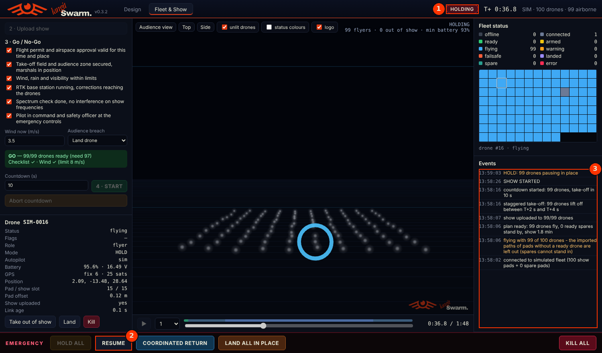
*After HOLD ALL: the state shows HOLDING (1), RESUME becomes available (2), and the event log
records what happened (3).*

---

## 11. Flying real drones

Do this only after the same show passed a full simulator rehearsal, with the drones' setup
checked on the bench.

1. Prepare every drone as described in the README ([Flying real drones](../README.md#flying-real-drones)):
   PX4 or ArduPilot parameters, RTK GPS, MAVLink system IDs, and the LED player script with the
   light file from the export package.
2. In **Safety & field settings → Location**, enter the exact coordinates of the take-off field
   and the direction the audience looks, then compile and validate again.
3. Place the drones on their pads (the export's `manifest.json` lists every pad).
4. **Fleet & Show → Type: Real drones — MAVLink UDP**, enter the UDP endpoint(s) of your radio
   network(s), **Connect**, then steps 1 to 4 exactly as in the rehearsal.

---

## 12. Troubleshooting

| Problem | What to do |
|---|---|
| "Windows protected your PC" | Click **More info → Run anyway** (the app is not code-signed yet). |
| Nothing seems to happen after double-clicking | Watch the console window: the first start can take up to a minute. |
| The app window stays black or blank | Wait about a minute — the app switches to your web browser by itself. Or double-click **Safe mode (no GPU).cmd**, or **Open in browser.cmd**. |
| Console says *WebView2 Runtime was not found* | The app opens in your browser instead. To get the app window, install Microsoft's *Evergreen WebView2 Runtime*. |
| The 3D view is black but the panels work | Use **Safe mode (no GPU).cmd**, or update the graphics driver. |
| A red ✗ in Safety validation | Read the check's detail line and adjust the formation it names ([section 6](#6-compile--validate)). |
| *NO-GO* before the show | The verdict line says why: not enough ready drones, checklist incomplete, or wind above the limit. |
| Something else | Send the log file `%USERPROFILE%\LangitSwarm\logs\launcher.log` (and a screenshot of the console). |

---

## 13. Where your files are

Everything you create is kept in **`%USERPROFILE%\LangitSwarm\`** (for example
`C:\Users\yourname\LangitSwarm\`):

| Folder | Contains |
|---|---|
| `shows\` | saved shows (and the automatic save of your current work) |
| `exports\` | export packages |
| `imports\` | imported Skybrush files |
| `logs\` | the launcher log and a flight log ("black box") of every show |

The app window's own data (cache) is in `%LOCALAPPDATA%\LangitSwarm\WebView2\`.

To see the exact folder on your computer, click the **logo** at the top left: the *About* box
shows it as **Data folder**.

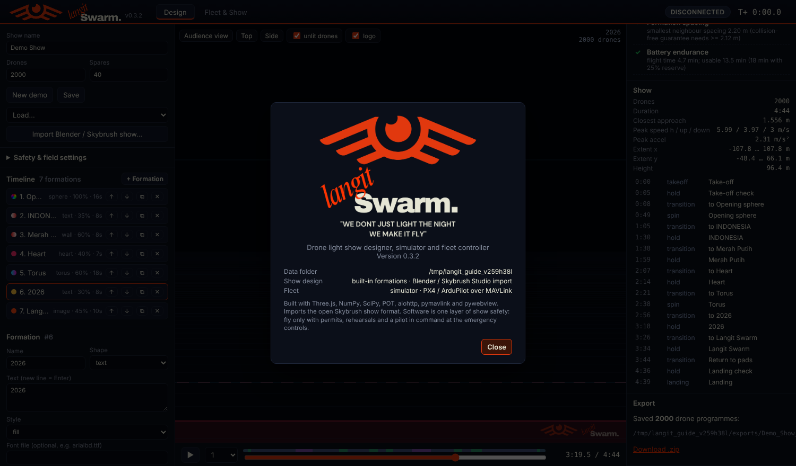
*The About box (in this screenshot the data folder is a test folder; on your PC it is
`C:\Users\<you>\LangitSwarm`).*

---

*Langit Swarm — "We don't just light the night, we make it fly."*
